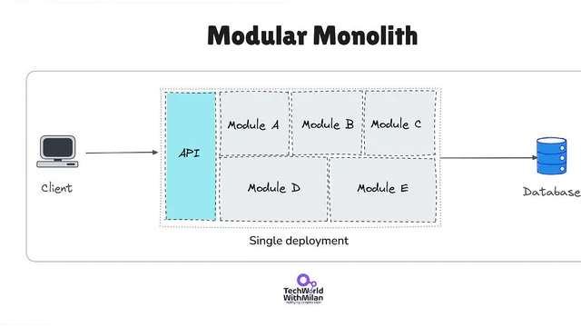
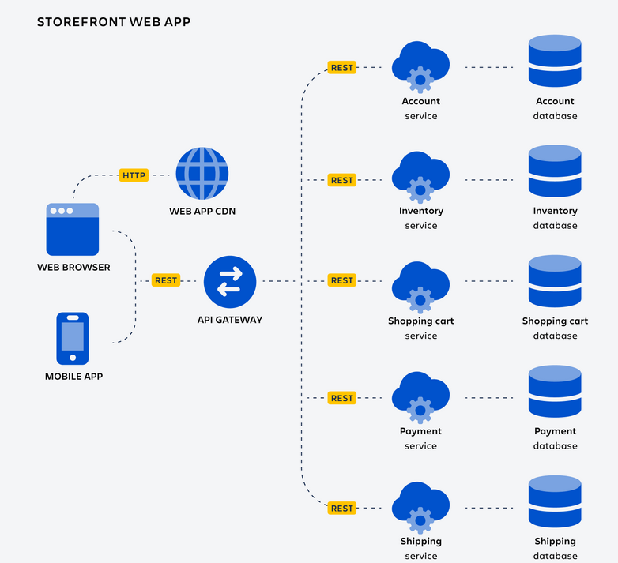
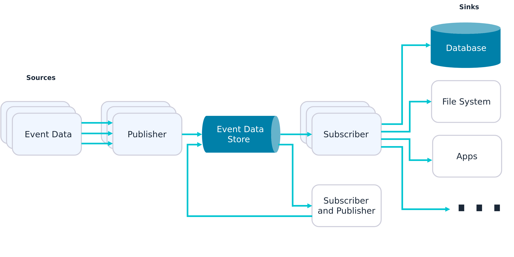
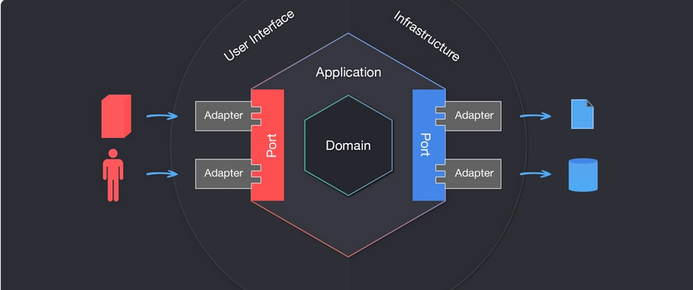

# - Monolithique

- une liste de caractéristiques
    ça contient une UI coté client 
    une BDD (relationnel)
    un seul déploiement (on livre tout d'un coup)

- une définition simple et efficace - avec vos mots
    c'est un livrable construit en un seul bloc, un seul conteneur docker. Si on doit faire un seul changement pour un simple bouton par exemple, on doit tout rebuild.
    Les modules communique via des fonctions et partage la même BDD

    il y a aussi le monolitique modulaire : la différence est qu'il est découper en domaine métier distinct. C'est l'organisation séparé du microservice. Mais la faciliter de déploiement du monolithique avec une bdd commune 
    
- une liste d'utilisation dans des projets connus

    monolithique : satckOverflow, synapse (projet perso)
    monolithique modulaire : Shopify

- la liste des sources utilisées

ARCH UI permet de bloquer lors d'un appel illégale dans un monolithe modulaire. Ce qui strict 
https://www.reddit.com/r/softwarearchitecture/comments/1iomonq/what_is_a_modular_monolith/?tl=fr

https://www.ibm.com/fr-fr/think/topics/monolithic-architecture

https://www.atlassian.com/fr/microservices/microservices-architecture/microservices-vs-monolith

https://www.mulesoft.com/fr/api/microservices/monolithic-vs-microservices

# - Microservice

- une liste de caractéristiques
    module indépendant donc BDD unique a chque module
    communication entre service via API
    très représenter avec docker ou kubernetes

- une définition simple et efficace - avec vos mots
    ça divise une app en série de services déployable indépendamment qui communique via API. Plutôt orienter app complexe pour faciliter le maintient et une livraison rapide. ça facilite aussi les tests et l'ajout de feature. 
    Chaque module a sa propre BDD 
- une liste d'utilisation dans des projets connus
    amazone
    uber
    spotify
- la liste des sources utilisées

https://www.atlassian.com/fr/microservices/microservices-architecture
https://www.atlassian.com/fr/microservices/microservices-architecture/microservices-vs-monolith
https://www.mulesoft.com/fr/api/microservices/monolithic-vs-microservices
https://www.ibm.com/fr-fr/think/topics/microservices-design-patterns

# - Event-Driven (EDA)

- une liste de caractéristiques
    envoie des notification temps réel a l'user d'evenement
    Broker : tableau où son posé les évènements
    asynchrone
    une sorte de "broadcast"
    Event Sourcing (les logs de chaque modif faites sous une séquence d'event)

- une définition simple et efficace - avec vos mots
    c'est une architecture qui vien découpler les composant. Quand un état change, ça publie l'info au Broker qui le transmet ensuite a ses abonnées.
    ça répond pas trop au même besoin que les autres architecture. Le découpage et deploy est monolithique ou microservice, les parties communique en API ou EDA et l'organisation de code est hexagonale ou en couche.

- une liste d'utilisation dans des projets connus
Netflix
amazon
- la liste des sources utilisées
https://www.ibm.com/fr-fr/think/topics/event-driven-architecture
https://www.redhat.com/fr/topics/integration/what-is-event-driven-architecture
https://www.groupeonepoint.com/fr/publications/event-driven-architecture-un-modele-darchitecture-repondant-aux-enjeux-daujourdhui-et-de-demain/

# - Hexagonale

- une liste de caractéristiques
    vise a être indépendant des acteur externe (api, bdd, test, SMTP)
    communique d'un noyaut central vers des port et adapteur
    permet de faciliter les remplacer des acteurs externes et faire evolue le code métier indépendamment 
    adaptateur secondaire (permet de d'interrargir avec le métier extérieur (BDD, API, SMTP ect))
    Les dépendance pointe toujour de l'exterieur(infra) vers l'intérieur(domaine)
    grace aux ports, ça permet de faires des tests directement en mémoire en étant complètement en dehord du métier

- une définition simple et efficace - avec vos mots
    c'est une architeture d'organisation de code qui vise a créer une séparation entre la logique métier et la technique. 

- une liste d'utilisation dans des projets connus
- la liste des sources utilisées

https://blog.octo.com/architecture-hexagonale-trois-principes-et-un-exemple-dimplementation
https://www.reddit.com/r/softwarearchitecture/comments/1pb9zge/i_finally_understood_hexagonal_architecture_after/?tl=fr
https://www.numendo.com/blog/back/architecture-hexagonale-principes-avantages-et-implementation-pratique/